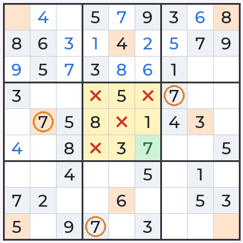

<!-- Written by tools/walkthrough.py girandola: edit the script, not this page. -->
# Girandola, step 13: the 7 in box 5

**Step 13 of 45** · [← Step 12](step-12.md) · [All steps](../girandola.md#the-whole-puzzle-step-by-step) · [Step 14 →](step-14.md)

Box 5 needs a 7. r4c4 and r4c6: row 4 has one (r4c7). r5c5: row 5 has one (r5c2). r6c4: column 4 has one (r9c4). Only **r6c6** is left: **r6c6 = 7**.

**Step 13 of 45** · [← Step 12](step-12.md) · [All steps](../girandola.md#the-whole-puzzle-step-by-step) · [Step 14 →](step-14.md)
