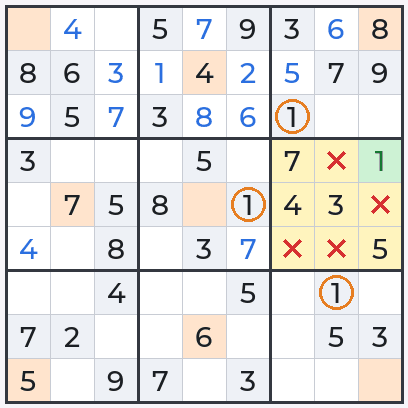

<!-- Written by tools/walkthrough.py girandola: edit the script, not this page. -->
# Girandola, step 14: the 1 in box 6

**Step 14 of 45** · [← Step 13](step-13.md) · [All steps](../girandola.md#the-whole-puzzle-step-by-step) · [Step 15 →](step-15.md)

Box 6 needs a 1. r4c8 and r6c8: column 8 has one (r7c8). r5c9: row 5 has one (r5c6). r6c7: column 7 has one (r3c7). Only **r4c9** is left: **r4c9 = 1**.

**Step 14 of 45** · [← Step 13](step-13.md) · [All steps](../girandola.md#the-whole-puzzle-step-by-step) · [Step 15 →](step-15.md)
