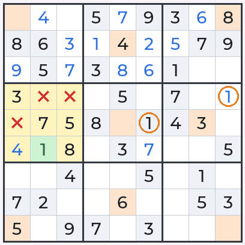

<!-- Written by tools/walkthrough.py girandola: edit the script, not this page. -->
# Girandola, step 15: the 1 in box 4

**Step 15 of 45** · [← Step 14](step-14.md) · [All steps](../girandola.md#the-whole-puzzle-step-by-step) · [Step 16 →](step-16.md)

Box 4 needs a 1. r4c2 and r4c3: row 4 has one (r4c9). r5c1: row 5 has one (r5c6). Only **r6c2** is left: **r6c2 = 1**.

**Step 15 of 45** · [← Step 14](step-14.md) · [All steps](../girandola.md#the-whole-puzzle-step-by-step) · [Step 16 →](step-16.md)
