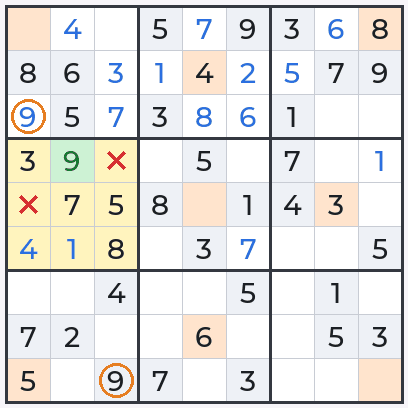

<!-- Written by tools/walkthrough.py girandola: edit the script, not this page. -->
# Girandola, step 16: the 9 in box 4

**Step 16 of 45** · [← Step 15](step-15.md) · [All steps](../girandola.md#the-whole-puzzle-step-by-step) · [Step 17 →](step-17.md)

Box 4 needs a 9. r4c3: column 3 has one (r9c3). r5c1: column 1 has one (r3c1). Only **r4c2** is left: **r4c2 = 9**.

**Step 16 of 45** · [← Step 15](step-15.md) · [All steps](../girandola.md#the-whole-puzzle-step-by-step) · [Step 17 →](step-17.md)
