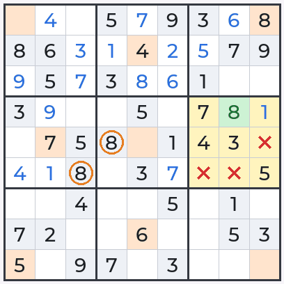

<!-- Written by tools/walkthrough.py girandola: edit the script, not this page. -->
# Girandola, step 17: the 8 in box 6

**Step 17 of 45** · [← Step 16](step-16.md) · [All steps](../girandola.md#the-whole-puzzle-step-by-step) · [Step 18 →](step-18.md)

Box 6 needs an 8. r5c9: row 5 has one (r5c4). r6c7 and r6c8: row 6 has one (r6c3). Only **r4c8** is left: **r4c8 = 8**.

**Step 17 of 45** · [← Step 16](step-16.md) · [All steps](../girandola.md#the-whole-puzzle-step-by-step) · [Step 18 →](step-18.md)
