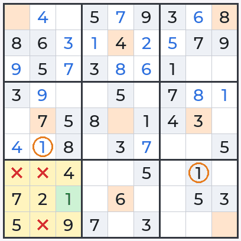

<!-- Written by tools/walkthrough.py girandola: edit the script, not this page. -->
# Girandola, step 18: the 1 in box 7

**Step 18 of 45** · [← Step 17](step-17.md) · [All steps](../girandola.md#the-whole-puzzle-step-by-step) · [Step 19 →](step-19.md)

Box 7 needs a 1. r7c1 and r7c2: row 7 has one (r7c8). r9c2: column 2 has one (r6c2). Only **r8c3** is left: **r8c3 = 1**.

**Step 18 of 45** · [← Step 17](step-17.md) · [All steps](../girandola.md#the-whole-puzzle-step-by-step) · [Step 19 →](step-19.md)
