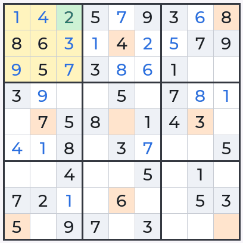

<!-- Written by tools/walkthrough.py girandola: edit the script, not this page. -->
# Girandola, step 20: the 2 in box 1

**Step 20 of 45** · [← Step 19](step-19.md) · [All steps](../girandola.md#the-whole-puzzle-step-by-step) · [Step 21 →](step-21.md)

Box 1 needs a 2, and r1c3 is its last empty cell: **r1c3 = 2**.

**Step 20 of 45** · [← Step 19](step-19.md) · [All steps](../girandola.md#the-whole-puzzle-step-by-step) · [Step 21 →](step-21.md)
