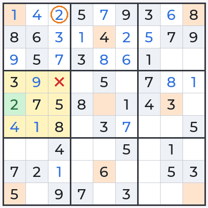

<!-- Written by tools/walkthrough.py girandola: edit the script, not this page. -->
# Girandola, step 21: the 2 in box 4

**Step 21 of 45** · [← Step 20](step-20.md) · [All steps](../girandola.md#the-whole-puzzle-step-by-step) · [Step 22 →](step-22.md)

Box 4 needs a 2. r4c3: column 3 has one (r1c3). Only **r5c1** is left: **r5c1 = 2**.

**Step 21 of 45** · [← Step 20](step-20.md) · [All steps](../girandola.md#the-whole-puzzle-step-by-step) · [Step 22 →](step-22.md)
