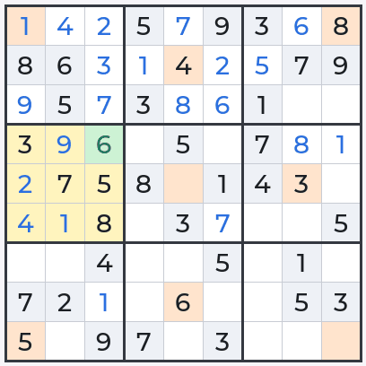

<!-- Written by tools/walkthrough.py girandola: edit the script, not this page. -->
# Girandola, step 22: the 6 in box 4

**Step 22 of 45** · [← Step 21](step-21.md) · [All steps](../girandola.md#the-whole-puzzle-step-by-step) · [Step 23 →](step-23.md)

Box 4 needs a 6, and r4c3 is its last empty cell: **r4c3 = 6**.

**Step 22 of 45** · [← Step 21](step-21.md) · [All steps](../girandola.md#the-whole-puzzle-step-by-step) · [Step 23 →](step-23.md)
