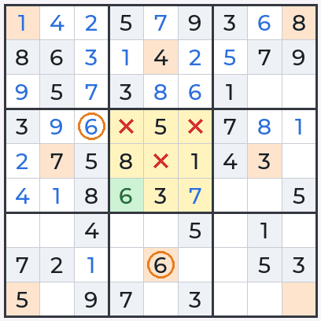

<!-- Written by tools/walkthrough.py girandola: edit the script, not this page. -->
# Girandola, step 23: the 6 in box 5

**Step 23 of 45** · [← Step 22](step-22.md) · [All steps](../girandola.md#the-whole-puzzle-step-by-step) · [Step 24 →](step-24.md)

Box 5 needs a 6. r4c4 and r4c6: row 4 has one (r4c3). r5c5: column 5 has one (r8c5). Only **r6c4** is left: **r6c4 = 6**.

**Step 23 of 45** · [← Step 22](step-22.md) · [All steps](../girandola.md#the-whole-puzzle-step-by-step) · [Step 24 →](step-24.md)
