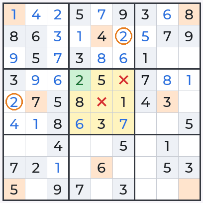

<!-- Written by tools/walkthrough.py girandola: edit the script, not this page. -->
# Girandola, step 24: the 2 in box 5

**Step 24 of 45** · [← Step 23](step-23.md) · [All steps](../girandola.md#the-whole-puzzle-step-by-step) · [Step 25 →](step-25.md)

Box 5 needs a 2. r4c6: column 6 has one (r2c6). r5c5: row 5 has one (r5c1). Only **r4c4** is left: **r4c4 = 2**.

**Step 24 of 45** · [← Step 23](step-23.md) · [All steps](../girandola.md#the-whole-puzzle-step-by-step) · [Step 25 →](step-25.md)
