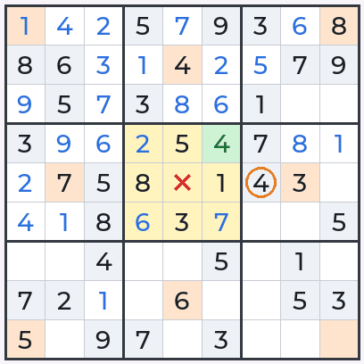

<!-- Written by tools/walkthrough.py girandola: edit the script, not this page. -->
# Girandola, step 25: the 4 in box 5

**Step 25 of 45** · [← Step 24](step-24.md) · [All steps](../girandola.md#the-whole-puzzle-step-by-step) · [Step 26 →](step-26.md)

Box 5 needs a 4. r5c5: row 5 has one (r5c7). Only **r4c6** is left: **r4c6 = 4**.

**Step 25 of 45** · [← Step 24](step-24.md) · [All steps](../girandola.md#the-whole-puzzle-step-by-step) · [Step 26 →](step-26.md)
