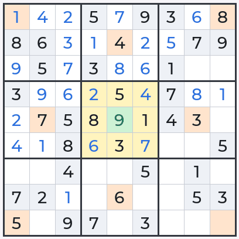

<!-- Written by tools/walkthrough.py girandola: edit the script, not this page. -->
# Girandola, step 26: the 9 in box 5

**Step 26 of 45** · [← Step 25](step-25.md) · [All steps](../girandola.md#the-whole-puzzle-step-by-step) · [Step 27 →](step-27.md)

Box 5 needs a 9, and r5c5 is its last empty cell: **r5c5 = 9**.

**Step 26 of 45** · [← Step 25](step-25.md) · [All steps](../girandola.md#the-whole-puzzle-step-by-step) · [Step 27 →](step-27.md)
