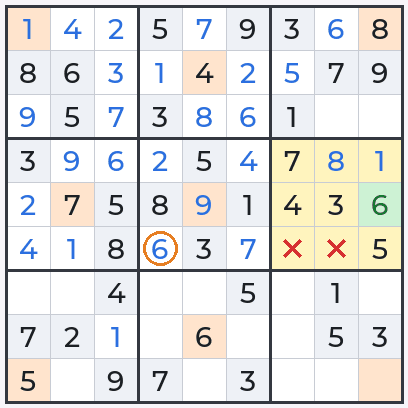

<!-- Written by tools/walkthrough.py girandola: edit the script, not this page. -->
# Girandola, step 27: the 6 in box 6

**Step 27 of 45** · [← Step 26](step-26.md) · [All steps](../girandola.md#the-whole-puzzle-step-by-step) · [Step 28 →](step-28.md)

Box 6 needs a 6. r6c7 and r6c8: row 6 has one (r6c4). Only **r5c9** is left: **r5c9 = 6**.

**Step 27 of 45** · [← Step 26](step-26.md) · [All steps](../girandola.md#the-whole-puzzle-step-by-step) · [Step 28 →](step-28.md)
