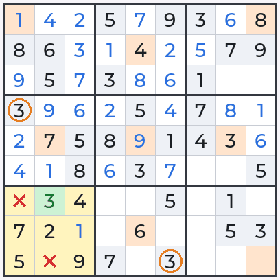

<!-- Written by tools/walkthrough.py girandola: edit the script, not this page. -->
# Girandola, step 28: the 3 in box 7

**Step 28 of 45** · [← Step 27](step-27.md) · [All steps](../girandola.md#the-whole-puzzle-step-by-step) · [Step 29 →](step-29.md)

Box 7 needs a 3. r7c1: column 1 has one (r4c1). r9c2: row 9 has one (r9c6). Only **r7c2** is left: **r7c2 = 3**.

**Step 28 of 45** · [← Step 27](step-27.md) · [All steps](../girandola.md#the-whole-puzzle-step-by-step) · [Step 29 →](step-29.md)
