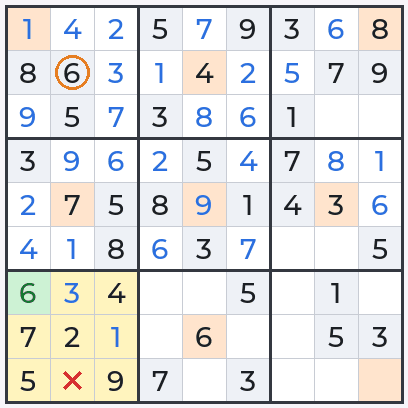

<!-- Written by tools/walkthrough.py girandola: edit the script, not this page. -->
# Girandola, step 29: the 6 in box 7

**Step 29 of 45** · [← Step 28](step-28.md) · [All steps](../girandola.md#the-whole-puzzle-step-by-step) · [Step 30 →](step-30.md)

Box 7 needs a 6. r9c2: column 2 has one (r2c2). Only **r7c1** is left: **r7c1 = 6**.

**Step 29 of 45** · [← Step 28](step-28.md) · [All steps](../girandola.md#the-whole-puzzle-step-by-step) · [Step 30 →](step-30.md)
