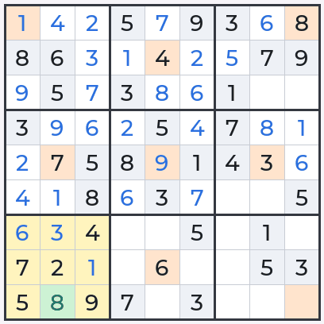

<!-- Written by tools/walkthrough.py girandola: edit the script, not this page. -->
# Girandola, step 30: the 8 in box 7

**Step 30 of 45** · [← Step 29](step-29.md) · [All steps](../girandola.md#the-whole-puzzle-step-by-step) · [Step 31 →](step-31.md)

Box 7 needs an 8, and r9c2 is its last empty cell: **r9c2 = 8**.

**Step 30 of 45** · [← Step 29](step-29.md) · [All steps](../girandola.md#the-whole-puzzle-step-by-step) · [Step 31 →](step-31.md)
