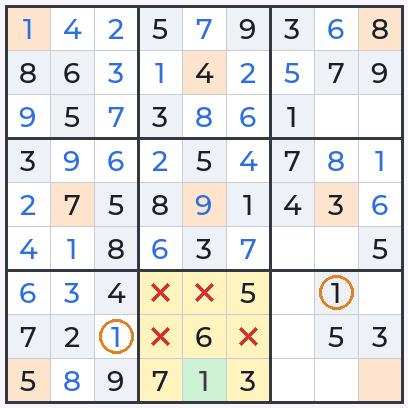

<!-- Written by tools/walkthrough.py girandola: edit the script, not this page. -->
# Girandola, step 31: the 1 in box 8

**Step 31 of 45** · [← Step 30](step-30.md) · [All steps](../girandola.md#the-whole-puzzle-step-by-step) · [Step 32 →](step-32.md)

Box 8 needs a 1. r7c4 and r7c5: row 7 has one (r7c8). r8c4 and r8c6: row 8 has one (r8c3). Only **r9c5** is left: **r9c5 = 1**.

**Step 31 of 45** · [← Step 30](step-30.md) · [All steps](../girandola.md#the-whole-puzzle-step-by-step) · [Step 32 →](step-32.md)
