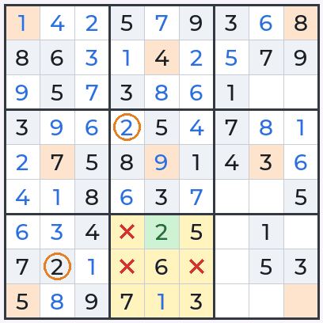

<!-- Written by tools/walkthrough.py girandola: edit the script, not this page. -->
# Girandola, step 32: the 2 in box 8

**Step 32 of 45** · [← Step 31](step-31.md) · [All steps](../girandola.md#the-whole-puzzle-step-by-step) · [Step 33 →](step-33.md)

Box 8 needs a 2. r7c4: column 4 has one (r4c4). r8c4 and r8c6: row 8 has one (r8c2). Only **r7c5** is left: **r7c5 = 2**.

**Step 32 of 45** · [← Step 31](step-31.md) · [All steps](../girandola.md#the-whole-puzzle-step-by-step) · [Step 33 →](step-33.md)
