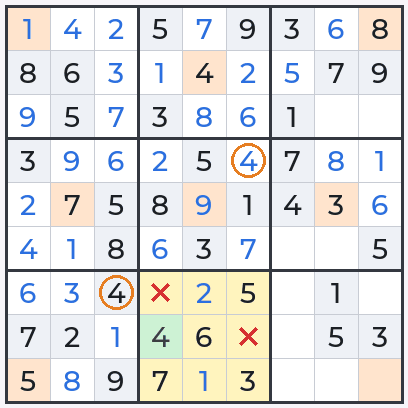

<!-- Written by tools/walkthrough.py girandola: edit the script, not this page. -->
# Girandola, step 33: the 4 in box 8

**Step 33 of 45** · [← Step 32](step-32.md) · [All steps](../girandola.md#the-whole-puzzle-step-by-step) · [Step 34 →](step-34.md)

Box 8 needs a 4. r7c4: row 7 has one (r7c3). r8c6: column 6 has one (r4c6). Only **r8c4** is left: **r8c4 = 4**.

**Step 33 of 45** · [← Step 32](step-32.md) · [All steps](../girandola.md#the-whole-puzzle-step-by-step) · [Step 34 →](step-34.md)
