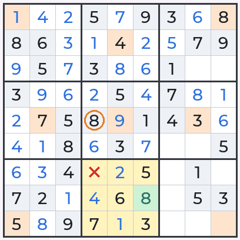

<!-- Written by tools/walkthrough.py girandola: edit the script, not this page. -->
# Girandola, step 34: the 8 in box 8

**Step 34 of 45** · [← Step 33](step-33.md) · [All steps](../girandola.md#the-whole-puzzle-step-by-step) · [Step 35 →](step-35.md)

Box 8 needs an 8. r7c4: column 4 has one (r5c4). Only **r8c6** is left: **r8c6 = 8**.

**Step 34 of 45** · [← Step 33](step-33.md) · [All steps](../girandola.md#the-whole-puzzle-step-by-step) · [Step 35 →](step-35.md)
