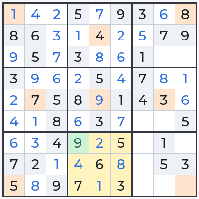

<!-- Written by tools/walkthrough.py girandola: edit the script, not this page. -->
# Girandola, step 35: the 9 in box 8

**Step 35 of 45** · [← Step 34](step-34.md) · [All steps](../girandola.md#the-whole-puzzle-step-by-step) · [Step 36 →](step-36.md)

Box 8 needs a 9, and r7c4 is its last empty cell: **r7c4 = 9**.

**Step 35 of 45** · [← Step 34](step-34.md) · [All steps](../girandola.md#the-whole-puzzle-step-by-step) · [Step 36 →](step-36.md)
