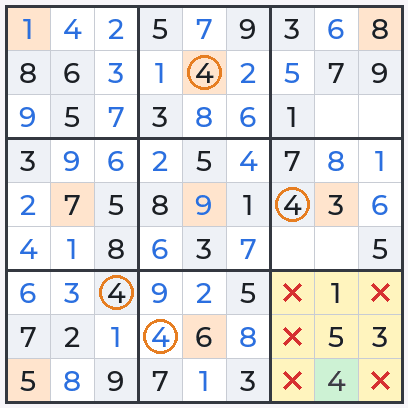

<!-- Written by tools/walkthrough.py girandola: edit the script, not this page. -->
# Girandola, step 36: the 4 in box 9

**Step 36 of 45** · [← Step 35](step-35.md) · [All steps](../girandola.md#the-whole-puzzle-step-by-step) · [Step 37 →](step-37.md)

Box 9 needs a 4. r7c7 and r7c9: row 7 has one (r7c3). r8c7: row 8 has one (r8c4). r9c7: column 7 has one (r5c7). r9c9: the pinwheel has one (r2c5). Only **r9c8** is left: **r9c8 = 4**.

**Step 36 of 45** · [← Step 35](step-35.md) · [All steps](../girandola.md#the-whole-puzzle-step-by-step) · [Step 37 →](step-37.md)
