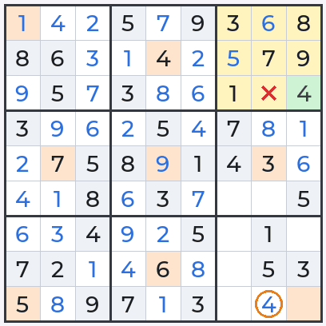

<!-- Written by tools/walkthrough.py girandola: edit the script, not this page. -->
# Girandola, step 37: the 4 in box 3

**Step 37 of 45** · [← Step 36](step-36.md) · [All steps](../girandola.md#the-whole-puzzle-step-by-step) · [Step 38 →](step-38.md)

Box 3 needs a 4. r3c8: column 8 has one (r9c8). Only **r3c9** is left: **r3c9 = 4**.

**Step 37 of 45** · [← Step 36](step-36.md) · [All steps](../girandola.md#the-whole-puzzle-step-by-step) · [Step 38 →](step-38.md)
