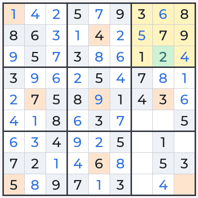

<!-- Written by tools/walkthrough.py girandola: edit the script, not this page. -->
# Girandola, step 38: the 2 in box 3

**Step 38 of 45** · [← Step 37](step-37.md) · [All steps](../girandola.md#the-whole-puzzle-step-by-step) · [Step 39 →](step-39.md)

Box 3 needs a 2, and r3c8 is its last empty cell: **r3c8 = 2**.

**Step 38 of 45** · [← Step 37](step-37.md) · [All steps](../girandola.md#the-whole-puzzle-step-by-step) · [Step 39 →](step-39.md)
