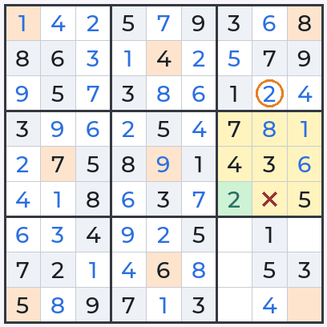

<!-- Written by tools/walkthrough.py girandola: edit the script, not this page. -->
# Girandola, step 39: the 2 in box 6

**Step 39 of 45** · [← Step 38](step-38.md) · [All steps](../girandola.md#the-whole-puzzle-step-by-step) · [Step 40 →](step-40.md)

Box 6 needs a 2. r6c8: column 8 has one (r3c8). Only **r6c7** is left: **r6c7 = 2**.

**Step 39 of 45** · [← Step 38](step-38.md) · [All steps](../girandola.md#the-whole-puzzle-step-by-step) · [Step 40 →](step-40.md)
