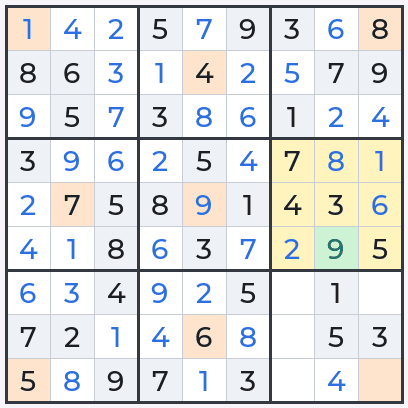

<!-- Written by tools/walkthrough.py girandola: edit the script, not this page. -->
# Girandola, step 40: the 9 in box 6

**Step 40 of 45** · [← Step 39](step-39.md) · [All steps](../girandola.md#the-whole-puzzle-step-by-step) · [Step 41 →](step-41.md)

Box 6 needs a 9, and r6c8 is its last empty cell: **r6c8 = 9**.

**Step 40 of 45** · [← Step 39](step-39.md) · [All steps](../girandola.md#the-whole-puzzle-step-by-step) · [Step 41 →](step-41.md)
