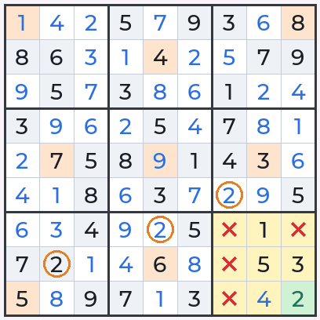

<!-- Written by tools/walkthrough.py girandola: edit the script, not this page. -->
# Girandola, step 41: the 2 in box 9

**Step 41 of 45** · [← Step 40](step-40.md) · [All steps](../girandola.md#the-whole-puzzle-step-by-step) · [Step 42 →](step-42.md)

Box 9 needs a 2. r7c7 and r7c9: row 7 has one (r7c5). r8c7: row 8 has one (r8c2). r9c7: column 7 has one (r6c7). Only **r9c9** is left: **r9c9 = 2**.

**Step 41 of 45** · [← Step 40](step-40.md) · [All steps](../girandola.md#the-whole-puzzle-step-by-step) · [Step 42 →](step-42.md)
