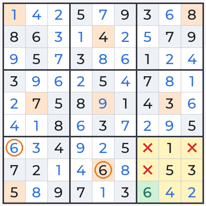

<!-- Written by tools/walkthrough.py girandola: edit the script, not this page. -->
# Girandola, step 42: the 6 in box 9

**Step 42 of 45** · [← Step 41](step-41.md) · [All steps](../girandola.md#the-whole-puzzle-step-by-step) · [Step 43 →](step-43.md)

Box 9 needs a 6. r7c7 and r7c9: row 7 has one (r7c1). r8c7: row 8 has one (r8c5). Only **r9c7** is left: **r9c7 = 6**.

**Step 42 of 45** · [← Step 41](step-41.md) · [All steps](../girandola.md#the-whole-puzzle-step-by-step) · [Step 43 →](step-43.md)
