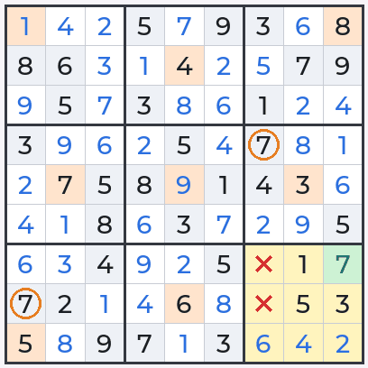

<!-- Written by tools/walkthrough.py girandola: edit the script, not this page. -->
# Girandola, step 43: the 7 in box 9

**Step 43 of 45** · [← Step 42](step-42.md) · [All steps](../girandola.md#the-whole-puzzle-step-by-step) · [Step 44 →](step-44.md)

Box 9 needs a 7. r7c7: column 7 has one (r4c7). r8c7: row 8 has one (r8c1). Only **r7c9** is left: **r7c9 = 7**.

**Step 43 of 45** · [← Step 42](step-42.md) · [All steps](../girandola.md#the-whole-puzzle-step-by-step) · [Step 44 →](step-44.md)
