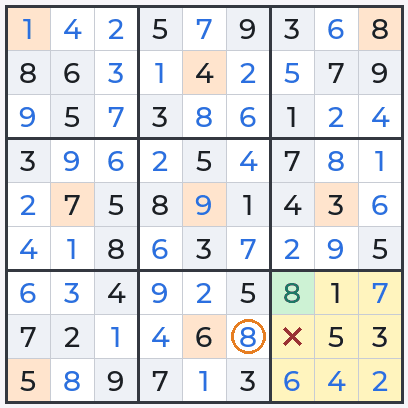

<!-- Written by tools/walkthrough.py girandola: edit the script, not this page. -->
# Girandola, step 44: the 8 in box 9

**Step 44 of 45** · [← Step 43](step-43.md) · [All steps](../girandola.md#the-whole-puzzle-step-by-step) · [Step 45 →](step-45.md)

Box 9 needs an 8. r8c7: row 8 has one (r8c6). Only **r7c7** is left: **r7c7 = 8**.

**Step 44 of 45** · [← Step 43](step-43.md) · [All steps](../girandola.md#the-whole-puzzle-step-by-step) · [Step 45 →](step-45.md)
