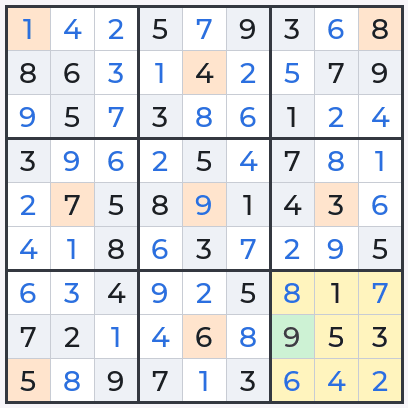

<!-- Written by tools/walkthrough.py girandola: edit the script, not this page. -->
# Girandola, step 45: the 9 in box 9

**Step 45 of 45** · [← Step 44](step-44.md) · [All steps](../girandola.md#the-whole-puzzle-step-by-step) · [All steps](../girandola.md#the-whole-puzzle-step-by-step)

Box 9 needs a 9, and r8c7 is its last empty cell: **r8c7 = 9**.

Solved.

**Step 45 of 45** · [← Step 44](step-44.md) · [All steps](../girandola.md#the-whole-puzzle-step-by-step) · [All steps](../girandola.md#the-whole-puzzle-step-by-step)
