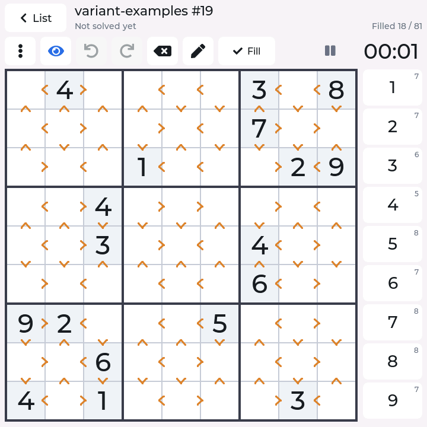

# Greater-Than

[← All variants](README.md) · [Puzzles](../features-puzzles.md) · [How to play](../how-to-play.md)



## The rules

[Classic](classic.md) rules, and inside each 3×3 box, a **sign** between every two side-by-side cells says which digit is bigger. The sign **points to the smaller digit**: in "3 < 8" the point faces the 3. There are no signs across box borders.

## On the board

- Each sign is an orange chevron on the line between two cells: ‹ › between left and right, ^ v between above and below, the point toward the smaller digit.
- Two digits that break a sign turn red.
- The grader and hints use the signs ("The signs around ... leave it only ..."), and also each cell's **range** from the chains of signs in its box: a cell bigger than three others, through the signs, is at least 4.
- **Puzzles → ⋮ → New puzzle → Greater-Than**. Givens are few: Easy keeps about 18, Medium about 4.

## How to solve it

- **Find the box's 1 and 9:** the 1 is smaller than all its neighbours (every sign points at it), the 9 bigger than all of them (every sign points away).
- **Follow the chains:** if a < b < c < d inside a box, a is at most 6 and d at least 4. A cell with four smaller neighbours chained behind them can be far from 1.
- **Sandwiched cells:** between "3 <" and "< 8", a cell is 4 to 7.
- Then let the Classic rules cut the range down, as in the worked example.

## Worked example

**variant-examples #19**, Greater-Than Easy (see [Classic](classic.md#worked-example) for how to import the examples; cells are written r*row*c*column*). The signs are in the screenshot.

```
. 4 . | . . . | 3 . 8
. . . | . . . | 7 . .
. . . | 1 . . | . 2 9
------+-------+------
. . 4 | . . . | . . .
. . 3 | . . . | 4 . .
. . . | . . . | 6 . .
------+-------+------
9 2 . | . . 5 | . . .
. . 6 | . . . | . . .
4 . 1 | . . . | . 3 .
```

**Step 1: r7c7, the top-left cell of box 9.** Row 7 has 9, 2 and 5; column 7 has 3, 7, 4 and 6; box 9 has a 3. By the Classic rules r7c7 could be 1 or 8. The signs say it's **smaller than r7c8** (to its right) and **smaller than r8c7** (below): two different cells of box 9 are bigger than it, and they can't both be 9. So r7c7 is at most 7. **r7c7 = 1**.

**Step 2: the 1 in row 1.** Row 1 needs a 1; its empty cells are r1c1, r1c3, r1c4, r1c5, r1c6 and r1c8.

- r1c3: column 3 has a 1 (r9c3).
- r1c4, r1c5, r1c6: box 2 has a 1 (r3c4).
- r1c8: the signs say **3 < r1c8 < 8** (it's between the 3 in r1c7 and the 8 in r1c9), so it's 4 to 7, not 1.

Only **r1c1** is left: **r1c1 = 1**.

**Step 3: the 1 in row 2.** Row 2 needs a 1 too:

- r2c1, r2c2: box 1 now has the 1 from step 2.
- r2c3: column 3 has a 1 (r9c3); r2c4, r2c5, r2c6: box 2 has a 1 (r3c4).
- r2c8: the sign below it says it's **bigger than r3c8**, which is a 2. So it's at least 3.

Only **r2c9** is left: **r2c9 = 1**.
