# Greater-Than

[← All variants](README.md) · [Puzzles](../features-puzzles.md) · [How to play](../how-to-play.md)


## The rules

[Classic](classic.md) rules, and inside each 3×3 box, a **sign** between every two side-by-side cells says which digit is bigger. The sign **points to the smaller digit**: in "3 < 8" the point faces the 3. There are no signs across box borders.

## On the board

- Each sign is an orange chevron on the line between two cells: ‹ › between left and right, ^ v between above and below, the point toward the smaller digit.
- Two digits that break a sign turn red.
- The grader and hints use the signs ("The signs around ... leave it only ..."), and also each cell's **range** from the chains of signs in its box: a cell bigger than three others, through the signs, is at least 4.
- **Puzzles → ⋮ → New puzzle → Greater-Than**. Givens are few: Easy keeps about 18, Medium about 4.

## How to solve it

- **Find the box's 1 and 9:** the 1 is smaller than all its neighbours (every sign points at it), the 9 bigger than all of them (every sign points away).
- **Follow the chains:** if a < b < c < d inside a box, a is at most 6 and d at least 4. A cell with four smaller neighbours chained behind them can be far from 1.
- **Sandwiched cells:** between "3 <" and "< 8", a cell is 4 to 7.
- Then let the Classic rules cut the range down, as in the worked example.

## Worked example

**variant-examples #19**, Greater-Than Easy (see [Classic](classic.md#worked-example) for how to import the examples; cells are written r*row*c*column*). The signs are in the screenshot.

```
. 4 . | . . . | 3 . 8
. . . | . . . | 7 . .
. . . | 1 . . | . 2 9
------+-------+------
. . 4 | . . . | . . .
. . 3 | . . . | 4 . .
. . . | . . . | 6 . .
------+-------+------
9 2 . | . . 5 | . . .
. . 6 | . . . | . . .
4 . 1 | . . . | . 3 .
```

**Step 1: r7c7, the top-left cell of box 9.** Row 7 has 9, 2 and 5; column 7 has 3, 7, 4 and 6; box 9 has a 3. By the Classic rules r7c7 could be 1 or 8. The signs say it's **smaller than r7c8** (to its right) and **smaller than r8c7** (below): two different cells of box 9 are bigger than it, and they can't both be 9. So r7c7 is at most 7. **r7c7 = 1**.

**Step 2: the 1 in row 1.** Row 1 needs a 1; its empty cells are r1c1, r1c3, r1c4, r1c5, r1c6 and r1c8.

- r1c3: column 3 has a 1 (r9c3).
- r1c4, r1c5, r1c6: box 2 has a 1 (r3c4).
- r1c8: the signs say **3 < r1c8 < 8** (it's between the 3 in r1c7 and the 8 in r1c9), so it's 4 to 7, not 1.

Only **r1c1** is left: **r1c1 = 1**.

**Step 3: the 1 in row 2.** Row 2 needs a 1 too:

- r2c1, r2c2: box 1 now has the 1 from step 2.
- r2c3: column 3 has a 1 (r9c3); r2c4, r2c5, r2c6: box 2 has a 1 (r3c4).
- r2c8: the sign below it says it's **bigger than r3c8**, which is a 2. So it's at least 3.

Only **r2c9** is left: **r2c9 = 1**.

## The whole puzzle, step by step

<!-- walkthrough -->
<!-- Written by tools/walkthrough.py greater-than: edit the script, not this part. -->

The whole puzzle, from the start to the last cell: 63 steps, each one a single (one place left for a digit, or one digit left for a cell), taken in the order a box's single comes first, so not quite the order of the worked example above. In each picture, the unit the step looks at is tinted yellow (for a cell with one digit left: its row, column and box), the new digit is on green, the digits that rule cells out have an **orange ring**, and the empty cells they rule out a **red cross**. Givens are on grey, digits from earlier steps in blue.

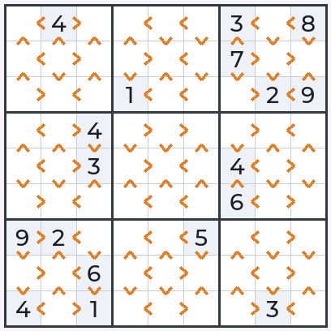

#### Step 1: the 1 in box 1

Box 1 needs a 1. r1c3 and r2c3: column 3 has one (r9c3). r3c1, r3c2 and r3c3: row 3 has one (r3c4). r2c1: the chains of signs in its box keep it between 2 and 7. r2c2: the chains of signs in its box keep it between 7 and 9. Only **r1c1** is left: **r1c1 = 1**.

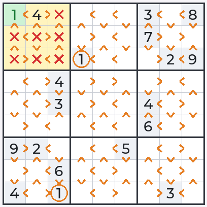

#### Step 2: the 9 in box 1

Box 1 needs a 9. r2c1: column 1 has one (r7c1). r3c1, r3c2 and r3c3: row 3 has one (r3c9). r1c3: the chains of signs in its box keep it between 1 and 5. r2c3: the chains of signs in its box keep it between 2 and 7. Only **r2c2** is left: **r2c2 = 9**.

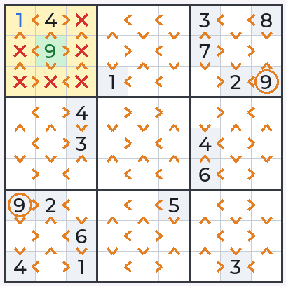

#### Step 3: the 9 in box 2

Box 2 needs a 9. r2c4, r2c5 and r2c6: row 2 has one (r2c2). r3c5 and r3c6: row 3 has one (r3c9). r1c4: the chains of signs in its box keep it between 1 and 6. r1c5: the chains of signs in its box keep it between 3 and 8. Only **r1c6** is left: **r1c6 = 9**.

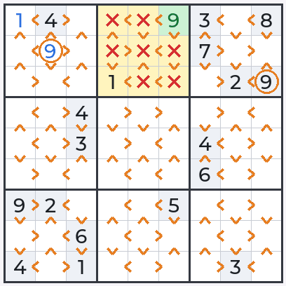

#### Step 4: the 1 in box 3

Box 3 needs a 1. r1c8: row 1 has one (r1c1). r3c7: row 3 has one (r3c4). r2c8: the chains of signs in its box keep it between 3 and 6. Only **r2c9** is left: **r2c9 = 1**.

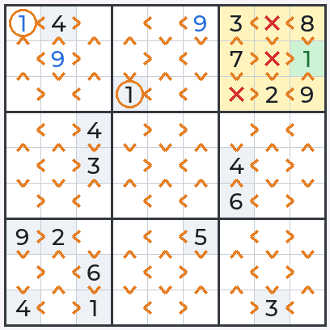

#### Step 5: the 4 in box 3

Box 3 needs a 4. r1c8: row 1 has one (r1c2). r3c7: column 7 has one (r5c7). Only **r2c8** is left: **r2c8 = 4**.

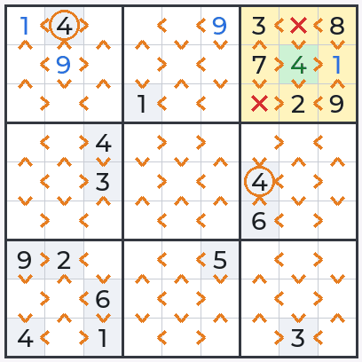

#### Step 6: the 6 in box 3

Box 3 needs a 6. r3c7: column 7 has one (r6c7). Only **r1c8** is left: **r1c8 = 6**.

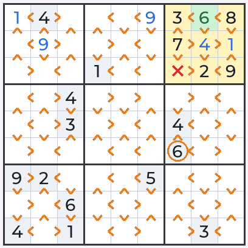

#### Step 7: the 5 in box 3

Box 3 needs a 5, and r3c7 is its last empty cell: **r3c7 = 5**.

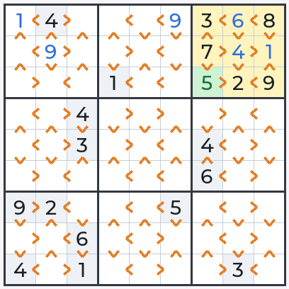

#### Step 8: the 1 in box 4

Box 4 needs a 1. r4c1, r5c1 and r6c1: column 1 has one (r1c1). r6c3: column 3 has one (r9c3). r4c2: the chains of signs in its box keep it between 4 and 8. r5c2: the chains of signs in its box keep it between 8 and 9. Only **r6c2** is left: **r6c2 = 1**.

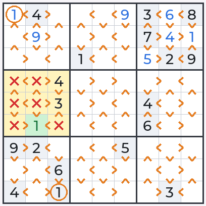

#### Step 9: the 9 in box 4

Box 4 needs a 9. r4c1, r5c1 and r6c1: column 1 has one (r7c1). r4c2 and r5c2: column 2 has one (r2c2). Only **r6c3** is left: **r6c3 = 9**.

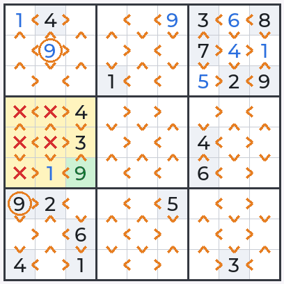

#### Step 10: the 9 in box 5

Box 5 needs a 9. r4c6 and r5c6: column 6 has one (r1c6). r6c4, r6c5 and r6c6: row 6 has one (r6c3). r4c5: the chains of signs in its box keep it between 3 and 8. r5c4: the chains of signs in its box keep it between 2 and 5. r5c5: the chains of signs in its box keep it between 1 and 2. Only **r4c4** is left: **r4c4 = 9**.

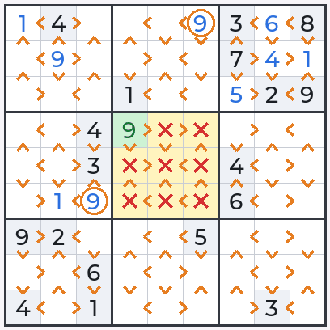

#### Step 11: the 1 in box 6

Box 6 needs a 1. r4c9 and r5c9: column 9 has one (r2c9). r6c8 and r6c9: row 6 has one (r6c2). r4c7: the chains of signs in its box keep it between 3 and 9. r5c8: the chains of signs in its box keep it between 8 and 9. Only **r4c8** is left: **r4c8 = 1**.

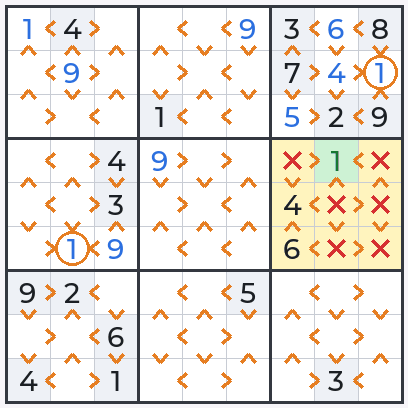

#### Step 12: the 1 in box 5

Box 5 needs a 1. r4c5 and r4c6: row 4 has one (r4c8). r5c4: column 4 has one (r3c4). r6c4, r6c5 and r6c6: row 6 has one (r6c2). r5c6: the chains of signs in its box keep it between 3 and 8. Only **r5c5** is left: **r5c5 = 1**.

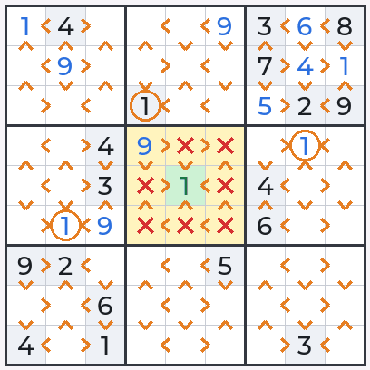

#### Step 13: the 9 in box 6

Box 6 needs a 9. r4c7 and r4c9: row 4 has one (r4c4). r5c9: column 9 has one (r3c9). r6c8 and r6c9: row 6 has one (r6c3). Only **r5c8** is left: **r5c8 = 9**.

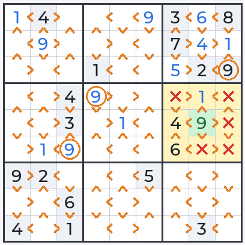

#### Step 14: the 3 in box 7

Box 7 needs a 3. r7c3: column 3 has one (r5c3). r9c2: row 9 has one (r9c8). r8c1: the chains of signs in its box keep it between 4 and 8. Only **r8c2** is left: **r8c2 = 3**.

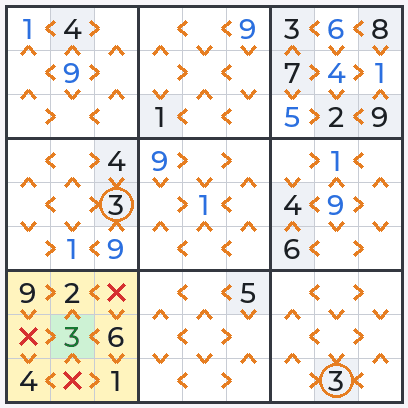

#### Step 15: the 3 in box 1

Box 1 needs a 3. r1c3: row 1 has one (r1c7). r2c3 and r3c3: column 3 has one (r5c3). r3c2: column 2 has one (r8c2). r3c1: the chains of signs in its box keep it between 4 and 9. Only **r2c1** is left: **r2c1 = 3**.

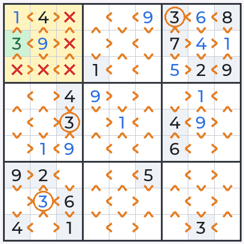

#### Step 16: the 5 in box 1

Box 1 needs a 5. r3c1, r3c2 and r3c3: row 3 has one (r3c7). r1c3: the sign says it's smaller than the 4 in r1c2. Only **r2c3** is left: **r2c3 = 5**.

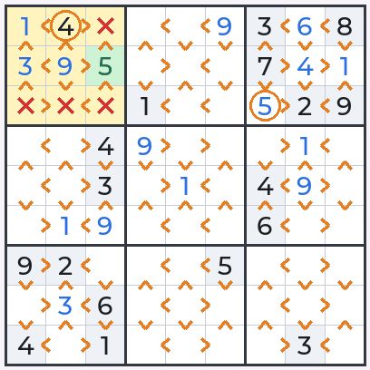

#### Step 17: the 2 in box 1

Box 1 needs a 2. r3c1, r3c2 and r3c3: row 3 has one (r3c8). Only **r1c3** is left: **r1c3 = 2**.

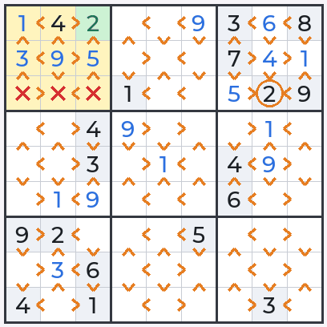

#### Step 18: the 2 in box 2

Box 2 needs a 2. r1c4 and r1c5: row 1 has one (r1c3). r3c5 and r3c6: row 3 has one (r3c8). r2c4: the chains of signs in its box keep it between 4 and 9. r2c6: the chains of signs in its box keep it between 5 and 8. Only **r2c5** is left: **r2c5 = 2**.

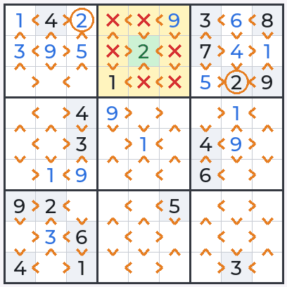

#### Step 19: the 3 in box 2

Box 2 needs a 3. r1c4 and r1c5: row 1 has one (r1c7). r2c4 and r2c6: row 2 has one (r2c1). r3c6: the chains of signs in its box keep it between 4 and 7. Only **r3c5** is left: **r3c5 = 3**.

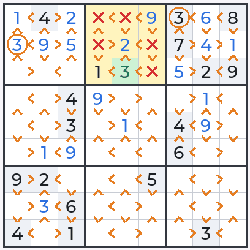

#### Step 20: the 4 in box 2

Box 2 needs a 4. r1c4 and r1c5: row 1 has one (r1c2). r2c4 and r2c6: row 2 has one (r2c8). Only **r3c6** is left: **r3c6 = 4**.

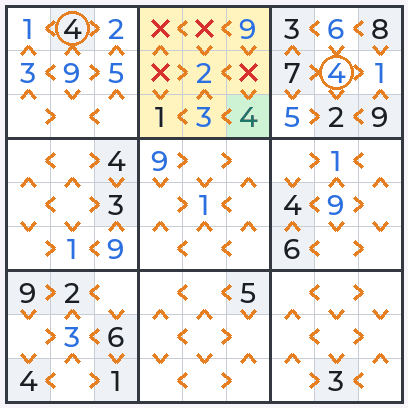

#### Step 21: the 7 in box 2

Box 2 needs a 7. r2c4 and r2c6: row 2 has one (r2c7). r1c4: the chains of signs in its box keep it between 1 and 6. Only **r1c5** is left: **r1c5 = 7**.

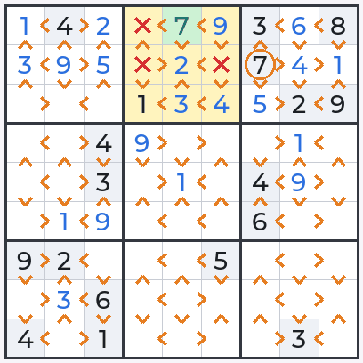

#### Step 22: the 5 in box 2

Box 2 needs a 5. r2c4 and r2c6: row 2 has one (r2c3). Only **r1c4** is left: **r1c4 = 5**.

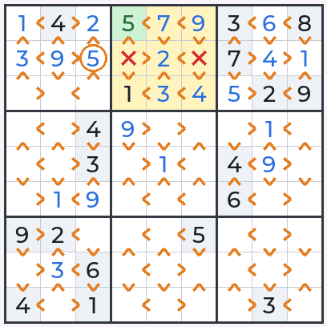

#### Step 23: the 1 in box 8

Box 8 needs a 1. r7c4 and r8c4: column 4 has one (r3c4). r7c5 and r8c5: column 5 has one (r5c5). r9c4, r9c5 and r9c6: row 9 has one (r9c3). Only **r8c6** is left: **r8c6 = 1**.

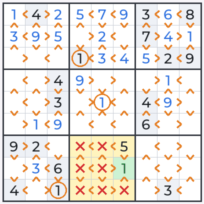

#### Step 24: the 3 in box 8

Box 8 needs a 3. r7c5: column 5 has one (r3c5). r8c4 and r8c5: row 8 has one (r8c2). r9c4, r9c5 and r9c6: row 9 has one (r9c8). Only **r7c4** is left: **r7c4 = 3**.

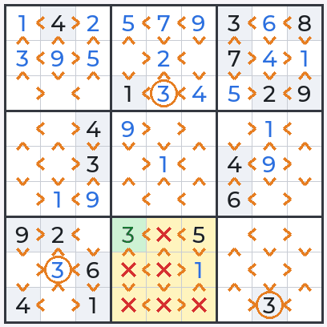

#### Step 25: the 3 in box 5

Box 5 needs a 3. r4c5 and r6c5: column 5 has one (r3c5). r5c4 and r5c6: row 5 has one (r5c3). r6c4: column 4 has one (r7c4). r6c6: the chains of signs in its box keep it between 7 and 9. Only **r4c6** is left: **r4c6 = 3**.

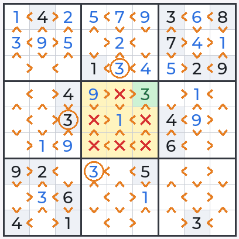

#### Step 26: the 2 in box 5

Box 5 needs a 2. r4c5 and r6c5: column 5 has one (r2c5). r5c6: the chains of signs in its box keep it between 3 and 8. r6c4: the chains of signs in its box keep it between 3 and 7. r6c6: the chains of signs in its box keep it between 7 and 9. Only **r5c4** is left: **r5c4 = 2**.

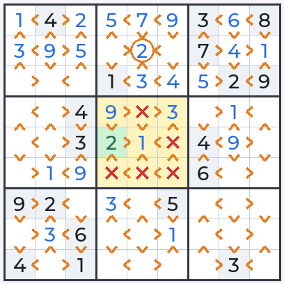

#### Step 27: the 3 in box 6

Box 6 needs a 3. r4c7 and r4c9: row 4 has one (r4c6). r5c9: row 5 has one (r5c3). r6c8: column 8 has one (r9c8). Only **r6c9** is left: **r6c9 = 3**.

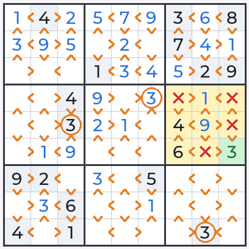

#### Step 28: the 2 in box 6

Box 6 needs a 2. r5c9: row 5 has one (r5c4). r6c8: column 8 has one (r3c8). r4c7: the chains of signs in its box keep it between 3 and 9. Only **r4c9** is left: **r4c9 = 2**.

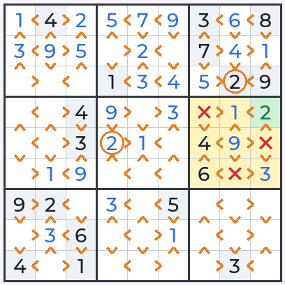

#### Step 29: the 2 in box 4

Box 4 needs a 2. r4c1 and r4c2: row 4 has one (r4c9). r5c1 and r5c2: row 5 has one (r5c4). Only **r6c1** is left: **r6c1 = 2**.

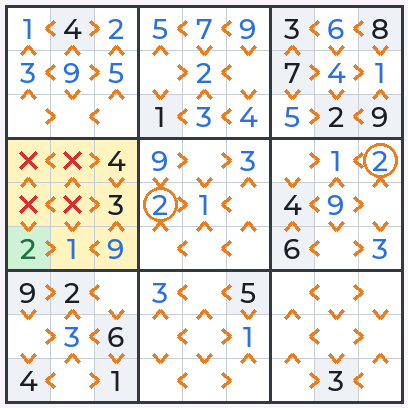

#### Step 30: the 5 in box 6

Box 6 needs a 5. r4c7: column 7 has one (r3c7). r6c8: the sign says it's bigger than the 6 in r6c7. Only **r5c9** is left: **r5c9 = 5**.

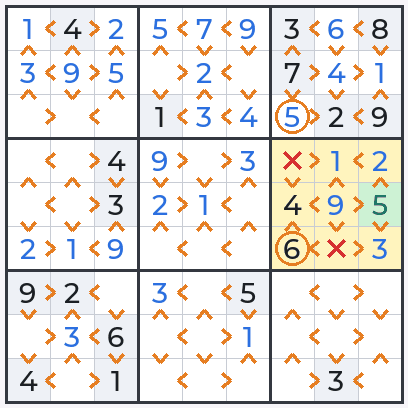

#### Step 31: the 7 in box 6

Box 6 needs a 7. r4c7: column 7 has one (r2c7). Only **r6c8** is left: **r6c8 = 7**.

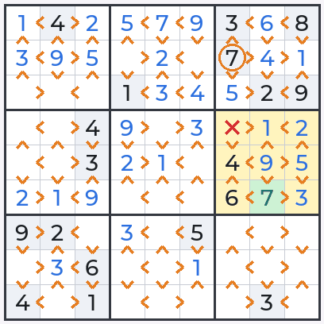

#### Step 32: the 7 in box 5

Box 5 needs a 7. r4c5: column 5 has one (r1c5). r6c4, r6c5 and r6c6: row 6 has one (r6c8). Only **r5c6** is left: **r5c6 = 7**.

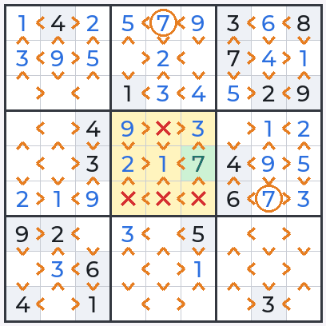

#### Step 33: the 7 in box 4

Box 4 needs a 7. r5c1 and r5c2: row 5 has one (r5c6). r4c1: the chains of signs in its box keep it between 1 and 6. Only **r4c2** is left: **r4c2 = 7**.

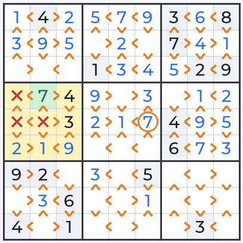

#### Step 34: the 5 in box 4

Box 4 needs a 5. r5c1 and r5c2: row 5 has one (r5c9). Only **r4c1** is left: **r4c1 = 5**.

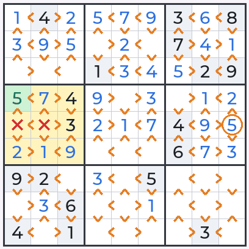

#### Step 35: the 6 in box 4

Box 4 needs a 6. r5c2: the chains of signs in its box keep it between 8 and 9. Only **r5c1** is left: **r5c1 = 6**.

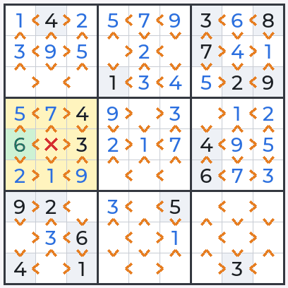

#### Step 36: the 6 in box 1

Box 1 needs a 6. r3c1: column 1 has one (r5c1). r3c3: column 3 has one (r8c3). Only **r3c2** is left: **r3c2 = 6**.

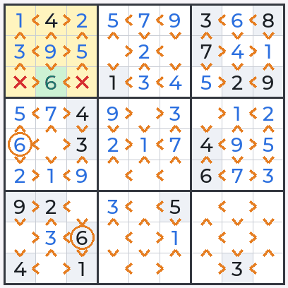

#### Step 37: the 8 in box 4

Box 4 needs an 8, and r5c2 is its last empty cell: **r5c2 = 8**.

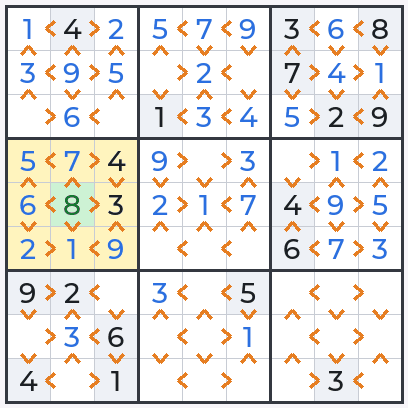

#### Step 38: the 5 in box 5

Box 5 needs a 5. r4c5: row 4 has one (r4c1). r6c4: column 4 has one (r1c4). r6c6: column 6 has one (r7c6). Only **r6c5** is left: **r6c5 = 5**.

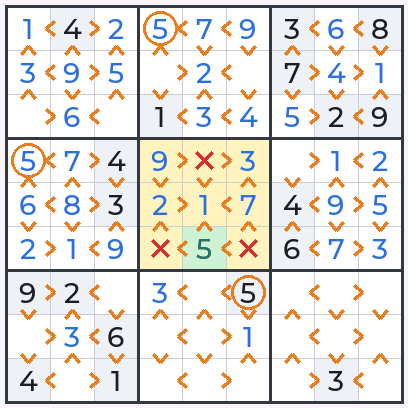

#### Step 39: the 4 in box 5

Box 5 needs a 4. r4c5: row 4 has one (r4c3). r6c6: column 6 has one (r3c6). Only **r6c4** is left: **r6c4 = 4**.

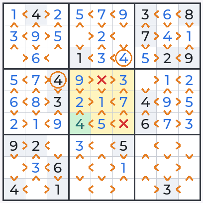

#### Step 40: the 6 in box 5

Box 5 needs a 6. r6c6: row 6 has one (r6c7). Only **r4c5** is left: **r4c5 = 6**.

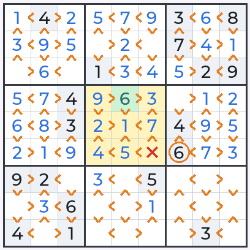

#### Step 41: the 8 in box 5

Box 5 needs an 8, and r6c6 is its last empty cell: **r6c6 = 8**.

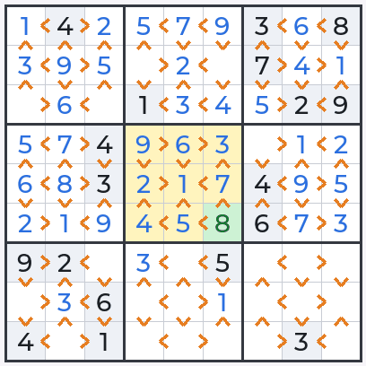

#### Step 42: the 8 in box 2

Box 2 needs an 8. r2c6: column 6 has one (r6c6). Only **r2c4** is left: **r2c4 = 8**.

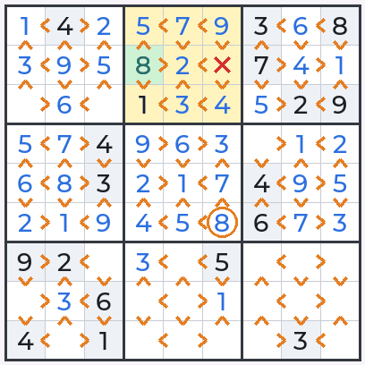

#### Step 43: the 6 in box 2

Box 2 needs a 6, and r2c6 is its last empty cell: **r2c6 = 6**.

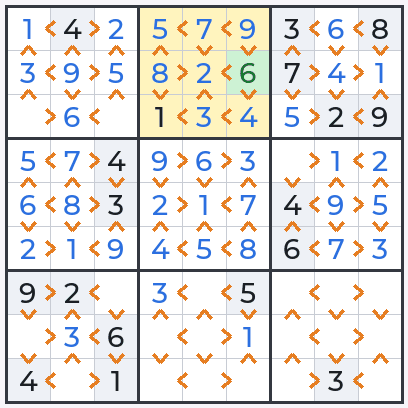

#### Step 44: the 8 in box 6

Box 6 needs an 8, and r4c7 is its last empty cell: **r4c7 = 8**.

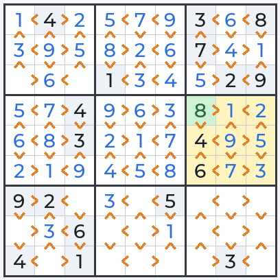

#### Step 45: the 5 in box 7

Box 7 needs a 5. r7c3: row 7 has one (r7c6). r8c1: column 1 has one (r4c1). Only **r9c2** is left: **r9c2 = 5**.

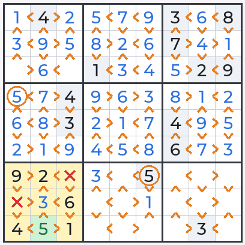

#### Step 46: the 2 in box 8

Box 8 needs a 2. r7c5: row 7 has one (r7c2). r8c4 and r9c4: column 4 has one (r5c4). r8c5 and r9c5: column 5 has one (r2c5). Only **r9c6** is left: **r9c6 = 2**.

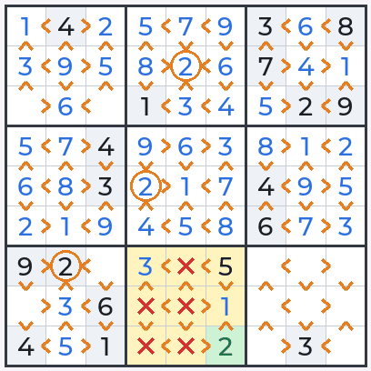

#### Step 47: the 4 in box 8

Box 8 needs a 4. r8c4: column 4 has one (r6c4). r9c4 and r9c5: row 9 has one (r9c1). r8c5: the chains of signs in its box keep it between 8 and 9. Only **r7c5** is left: **r7c5 = 4**.

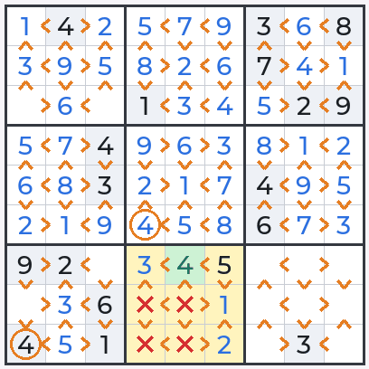

#### Step 48: the 6 in box 8

Box 8 needs a 6. r8c4 and r8c5: row 8 has one (r8c3). r9c5: column 5 has one (r4c5). Only **r9c4** is left: **r9c4 = 6**.

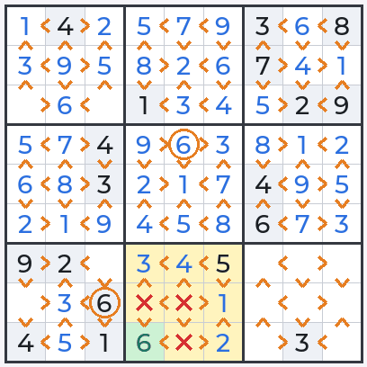

#### Step 49: the 7 in box 8

Box 8 needs a 7. r8c5 and r9c5: column 5 has one (r1c5). Only **r8c4** is left: **r8c4 = 7**.

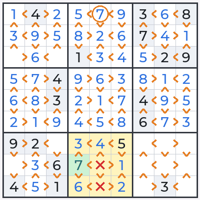

#### Step 50: the 7 in box 7

Box 7 needs a 7. r8c1: row 8 has one (r8c4). Only **r7c3** is left: **r7c3 = 7**.


#### Step 51: the 7 in box 1

Box 1 needs a 7. r3c3: column 3 has one (r7c3). Only **r3c1** is left: **r3c1 = 7**.


#### Step 52: the 8 in box 1

Box 1 needs an 8, and r3c3 is its last empty cell: **r3c3 = 8**.


#### Step 53: the 8 in box 7

Box 7 needs an 8, and r8c1 is its last empty cell: **r8c1 = 8**.


#### Step 54: the 8 in box 8

Box 8 needs an 8. r8c5: row 8 has one (r8c1). Only **r9c5** is left: **r9c5 = 8**.


#### Step 55: the 9 in box 8

Box 8 needs a 9, and r8c5 is its last empty cell: **r8c5 = 9**.


#### Step 56: the 1 in box 9

Box 9 needs a 1. r7c8: column 8 has one (r4c8). r7c9: column 9 has one (r2c9). r8c7, r8c8 and r8c9: row 8 has one (r8c6). r9c7 and r9c9: row 9 has one (r9c3). Only **r7c7** is left: **r7c7 = 1**.


#### Step 57: the 2 in box 9

Box 9 needs a 2. r7c8 and r7c9: row 7 has one (r7c2). r8c8: column 8 has one (r3c8). r8c9: column 9 has one (r4c9). r9c7 and r9c9: row 9 has one (r9c6). Only **r8c7** is left: **r8c7 = 2**.


#### Step 58: the 4 in box 9

Box 9 needs a 4. r7c8 and r7c9: row 7 has one (r7c5). r8c8: column 8 has one (r2c8). r9c7 and r9c9: row 9 has one (r9c1). Only **r8c9** is left: **r8c9 = 4**.


#### Step 59: the 5 in box 9

Box 9 needs a 5. r7c8 and r7c9: row 7 has one (r7c6). r9c7 and r9c9: row 9 has one (r9c2). Only **r8c8** is left: **r8c8 = 5**.


#### Step 60: the 6 in box 9

Box 9 needs a 6. r7c8: column 8 has one (r1c8). r9c7 and r9c9: row 9 has one (r9c4). Only **r7c9** is left: **r7c9 = 6**.


#### Step 61: the 7 in box 9

Box 9 needs a 7. r7c8: row 7 has one (r7c3). r9c7: column 7 has one (r2c7). Only **r9c9** is left: **r9c9 = 7**.


#### Step 62: the 8 in box 9

Box 9 needs an 8. r9c7: row 9 has one (r9c5). Only **r7c8** is left: **r7c8 = 8**.


#### Step 63: the 9 in box 9

Box 9 needs a 9, and r9c7 is its last empty cell: **r9c7 = 9**.


Solved.

<!-- /walkthrough -->
