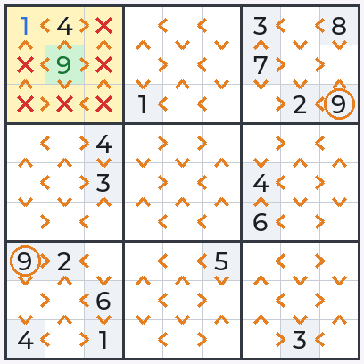

<!-- Written by tools/walkthrough.py greater-than: edit the script, not this page. -->
# Greater-Than, step 2: the 9 in box 1

**Step 2 of 63** · [← Step 1](step-01.md) · [All steps](../greater-than.md#the-whole-puzzle-step-by-step) · [Step 3 →](step-03.md)

Box 1 needs a 9. r2c1: column 1 has one (r7c1). r3c1, r3c2 and r3c3: row 3 has one (r3c9). r1c3: the chains of signs in its box keep it between 1 and 5. r2c3: the chains of signs in its box keep it between 2 and 7. Only **r2c2** is left: **r2c2 = 9**.

**Step 2 of 63** · [← Step 1](step-01.md) · [All steps](../greater-than.md#the-whole-puzzle-step-by-step) · [Step 3 →](step-03.md)
