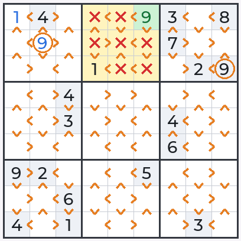

<!-- Written by tools/walkthrough.py greater-than: edit the script, not this page. -->
# Greater-Than, step 3: the 9 in box 2

**Step 3 of 63** · [← Step 2](step-02.md) · [All steps](../greater-than.md#the-whole-puzzle-step-by-step) · [Step 4 →](step-04.md)

Box 2 needs a 9. r2c4, r2c5 and r2c6: row 2 has one (r2c2). r3c5 and r3c6: row 3 has one (r3c9). r1c4: the chains of signs in its box keep it between 1 and 6. r1c5: the chains of signs in its box keep it between 3 and 8. Only **r1c6** is left: **r1c6 = 9**.

**Step 3 of 63** · [← Step 2](step-02.md) · [All steps](../greater-than.md#the-whole-puzzle-step-by-step) · [Step 4 →](step-04.md)
