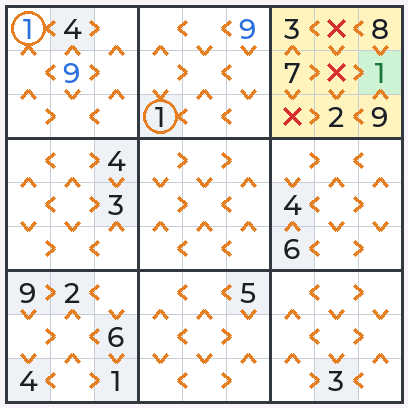

<!-- Written by tools/walkthrough.py greater-than: edit the script, not this page. -->
# Greater-Than, step 4: the 1 in box 3

**Step 4 of 63** · [← Step 3](step-03.md) · [All steps](../greater-than.md#the-whole-puzzle-step-by-step) · [Step 5 →](step-05.md)

Box 3 needs a 1. r1c8: row 1 has one (r1c1). r3c7: row 3 has one (r3c4). r2c8: the chains of signs in its box keep it between 3 and 6. Only **r2c9** is left: **r2c9 = 1**.

**Step 4 of 63** · [← Step 3](step-03.md) · [All steps](../greater-than.md#the-whole-puzzle-step-by-step) · [Step 5 →](step-05.md)
