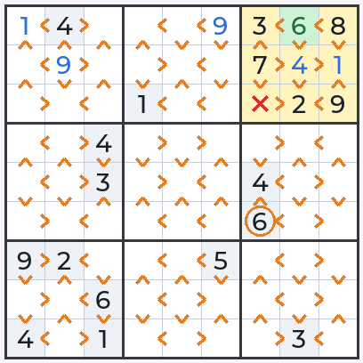

<!-- Written by tools/walkthrough.py greater-than: edit the script, not this page. -->
# Greater-Than, step 6: the 6 in box 3

**Step 6 of 63** · [← Step 5](step-05.md) · [All steps](../greater-than.md#the-whole-puzzle-step-by-step) · [Step 7 →](step-07.md)

Box 3 needs a 6. r3c7: column 7 has one (r6c7). Only **r1c8** is left: **r1c8 = 6**.

**Step 6 of 63** · [← Step 5](step-05.md) · [All steps](../greater-than.md#the-whole-puzzle-step-by-step) · [Step 7 →](step-07.md)
