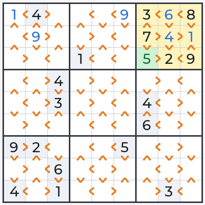

<!-- Written by tools/walkthrough.py greater-than: edit the script, not this page. -->
# Greater-Than, step 7: the 5 in box 3

**Step 7 of 63** · [← Step 6](step-06.md) · [All steps](../greater-than.md#the-whole-puzzle-step-by-step) · [Step 8 →](step-08.md)

Box 3 needs a 5, and r3c7 is its last empty cell: **r3c7 = 5**.

**Step 7 of 63** · [← Step 6](step-06.md) · [All steps](../greater-than.md#the-whole-puzzle-step-by-step) · [Step 8 →](step-08.md)
