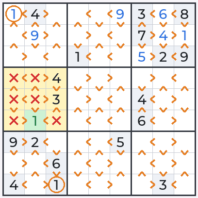

<!-- Written by tools/walkthrough.py greater-than: edit the script, not this page. -->
# Greater-Than, step 8: the 1 in box 4

**Step 8 of 63** · [← Step 7](step-07.md) · [All steps](../greater-than.md#the-whole-puzzle-step-by-step) · [Step 9 →](step-09.md)

Box 4 needs a 1. r4c1, r5c1 and r6c1: column 1 has one (r1c1). r6c3: column 3 has one (r9c3). r4c2: the chains of signs in its box keep it between 4 and 8. r5c2: the chains of signs in its box keep it between 8 and 9. Only **r6c2** is left: **r6c2 = 1**.

**Step 8 of 63** · [← Step 7](step-07.md) · [All steps](../greater-than.md#the-whole-puzzle-step-by-step) · [Step 9 →](step-09.md)
