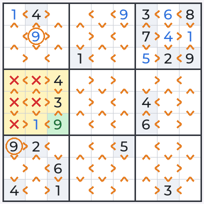

<!-- Written by tools/walkthrough.py greater-than: edit the script, not this page. -->
# Greater-Than, step 9: the 9 in box 4

**Step 9 of 63** · [← Step 8](step-08.md) · [All steps](../greater-than.md#the-whole-puzzle-step-by-step) · [Step 10 →](step-10.md)

Box 4 needs a 9. r4c1, r5c1 and r6c1: column 1 has one (r7c1). r4c2 and r5c2: column 2 has one (r2c2). Only **r6c3** is left: **r6c3 = 9**.

**Step 9 of 63** · [← Step 8](step-08.md) · [All steps](../greater-than.md#the-whole-puzzle-step-by-step) · [Step 10 →](step-10.md)
