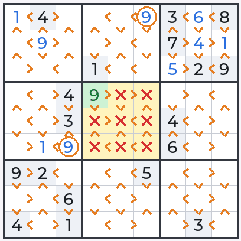

<!-- Written by tools/walkthrough.py greater-than: edit the script, not this page. -->
# Greater-Than, step 10: the 9 in box 5

**Step 10 of 63** · [← Step 9](step-09.md) · [All steps](../greater-than.md#the-whole-puzzle-step-by-step) · [Step 11 →](step-11.md)

Box 5 needs a 9. r4c6 and r5c6: column 6 has one (r1c6). r6c4, r6c5 and r6c6: row 6 has one (r6c3). r4c5: the chains of signs in its box keep it between 3 and 8. r5c4: the chains of signs in its box keep it between 2 and 5. r5c5: the chains of signs in its box keep it between 1 and 2. Only **r4c4** is left: **r4c4 = 9**.

**Step 10 of 63** · [← Step 9](step-09.md) · [All steps](../greater-than.md#the-whole-puzzle-step-by-step) · [Step 11 →](step-11.md)
