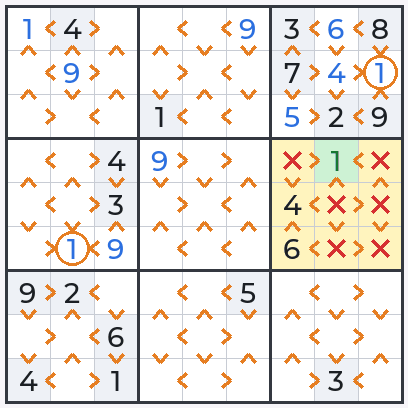

<!-- Written by tools/walkthrough.py greater-than: edit the script, not this page. -->
# Greater-Than, step 11: the 1 in box 6

**Step 11 of 63** · [← Step 10](step-10.md) · [All steps](../greater-than.md#the-whole-puzzle-step-by-step) · [Step 12 →](step-12.md)

Box 6 needs a 1. r4c9 and r5c9: column 9 has one (r2c9). r6c8 and r6c9: row 6 has one (r6c2). r4c7: the chains of signs in its box keep it between 3 and 9. r5c8: the chains of signs in its box keep it between 8 and 9. Only **r4c8** is left: **r4c8 = 1**.

**Step 11 of 63** · [← Step 10](step-10.md) · [All steps](../greater-than.md#the-whole-puzzle-step-by-step) · [Step 12 →](step-12.md)
