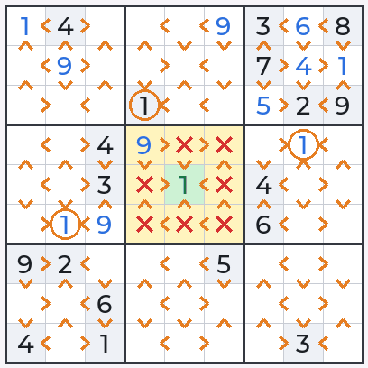

<!-- Written by tools/walkthrough.py greater-than: edit the script, not this page. -->
# Greater-Than, step 12: the 1 in box 5

**Step 12 of 63** · [← Step 11](step-11.md) · [All steps](../greater-than.md#the-whole-puzzle-step-by-step) · [Step 13 →](step-13.md)

Box 5 needs a 1. r4c5 and r4c6: row 4 has one (r4c8). r5c4: column 4 has one (r3c4). r6c4, r6c5 and r6c6: row 6 has one (r6c2). r5c6: the chains of signs in its box keep it between 3 and 8. Only **r5c5** is left: **r5c5 = 1**.

**Step 12 of 63** · [← Step 11](step-11.md) · [All steps](../greater-than.md#the-whole-puzzle-step-by-step) · [Step 13 →](step-13.md)
