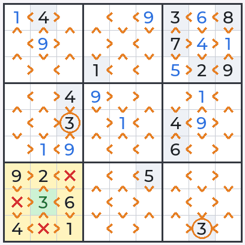

<!-- Written by tools/walkthrough.py greater-than: edit the script, not this page. -->
# Greater-Than, step 14: the 3 in box 7

**Step 14 of 63** · [← Step 13](step-13.md) · [All steps](../greater-than.md#the-whole-puzzle-step-by-step) · [Step 15 →](step-15.md)

Box 7 needs a 3. r7c3: column 3 has one (r5c3). r9c2: row 9 has one (r9c8). r8c1: the chains of signs in its box keep it between 4 and 8. Only **r8c2** is left: **r8c2 = 3**.

**Step 14 of 63** · [← Step 13](step-13.md) · [All steps](../greater-than.md#the-whole-puzzle-step-by-step) · [Step 15 →](step-15.md)
