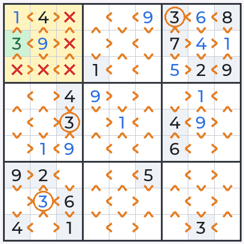

<!-- Written by tools/walkthrough.py greater-than: edit the script, not this page. -->
# Greater-Than, step 15: the 3 in box 1

**Step 15 of 63** · [← Step 14](step-14.md) · [All steps](../greater-than.md#the-whole-puzzle-step-by-step) · [Step 16 →](step-16.md)

Box 1 needs a 3. r1c3: row 1 has one (r1c7). r2c3 and r3c3: column 3 has one (r5c3). r3c2: column 2 has one (r8c2). r3c1: the chains of signs in its box keep it between 4 and 9. Only **r2c1** is left: **r2c1 = 3**.

**Step 15 of 63** · [← Step 14](step-14.md) · [All steps](../greater-than.md#the-whole-puzzle-step-by-step) · [Step 16 →](step-16.md)
