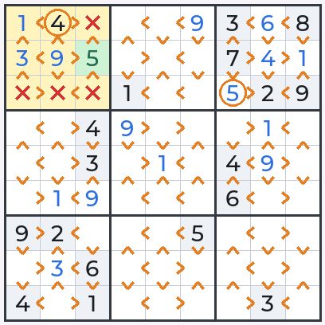

<!-- Written by tools/walkthrough.py greater-than: edit the script, not this page. -->
# Greater-Than, step 16: the 5 in box 1

**Step 16 of 63** · [← Step 15](step-15.md) · [All steps](../greater-than.md#the-whole-puzzle-step-by-step) · [Step 17 →](step-17.md)

Box 1 needs a 5. r3c1, r3c2 and r3c3: row 3 has one (r3c7). r1c3: the sign says it's smaller than the 4 in r1c2. Only **r2c3** is left: **r2c3 = 5**.

**Step 16 of 63** · [← Step 15](step-15.md) · [All steps](../greater-than.md#the-whole-puzzle-step-by-step) · [Step 17 →](step-17.md)
