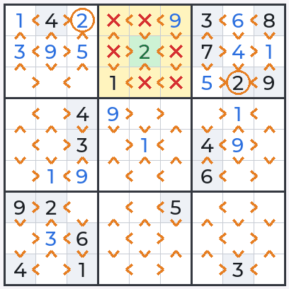

<!-- Written by tools/walkthrough.py greater-than: edit the script, not this page. -->
# Greater-Than, step 18: the 2 in box 2

**Step 18 of 63** · [← Step 17](step-17.md) · [All steps](../greater-than.md#the-whole-puzzle-step-by-step) · [Step 19 →](step-19.md)

Box 2 needs a 2. r1c4 and r1c5: row 1 has one (r1c3). r3c5 and r3c6: row 3 has one (r3c8). r2c4: the chains of signs in its box keep it between 4 and 9. r2c6: the chains of signs in its box keep it between 5 and 8. Only **r2c5** is left: **r2c5 = 2**.

**Step 18 of 63** · [← Step 17](step-17.md) · [All steps](../greater-than.md#the-whole-puzzle-step-by-step) · [Step 19 →](step-19.md)
