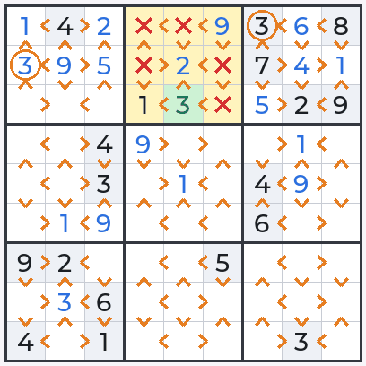

<!-- Written by tools/walkthrough.py greater-than: edit the script, not this page. -->
# Greater-Than, step 19: the 3 in box 2

**Step 19 of 63** · [← Step 18](step-18.md) · [All steps](../greater-than.md#the-whole-puzzle-step-by-step) · [Step 20 →](step-20.md)

Box 2 needs a 3. r1c4 and r1c5: row 1 has one (r1c7). r2c4 and r2c6: row 2 has one (r2c1). r3c6: the chains of signs in its box keep it between 4 and 7. Only **r3c5** is left: **r3c5 = 3**.

**Step 19 of 63** · [← Step 18](step-18.md) · [All steps](../greater-than.md#the-whole-puzzle-step-by-step) · [Step 20 →](step-20.md)
