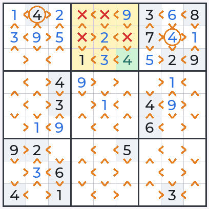

<!-- Written by tools/walkthrough.py greater-than: edit the script, not this page. -->
# Greater-Than, step 20: the 4 in box 2

**Step 20 of 63** · [← Step 19](step-19.md) · [All steps](../greater-than.md#the-whole-puzzle-step-by-step) · [Step 21 →](step-21.md)

Box 2 needs a 4. r1c4 and r1c5: row 1 has one (r1c2). r2c4 and r2c6: row 2 has one (r2c8). Only **r3c6** is left: **r3c6 = 4**.

**Step 20 of 63** · [← Step 19](step-19.md) · [All steps](../greater-than.md#the-whole-puzzle-step-by-step) · [Step 21 →](step-21.md)
